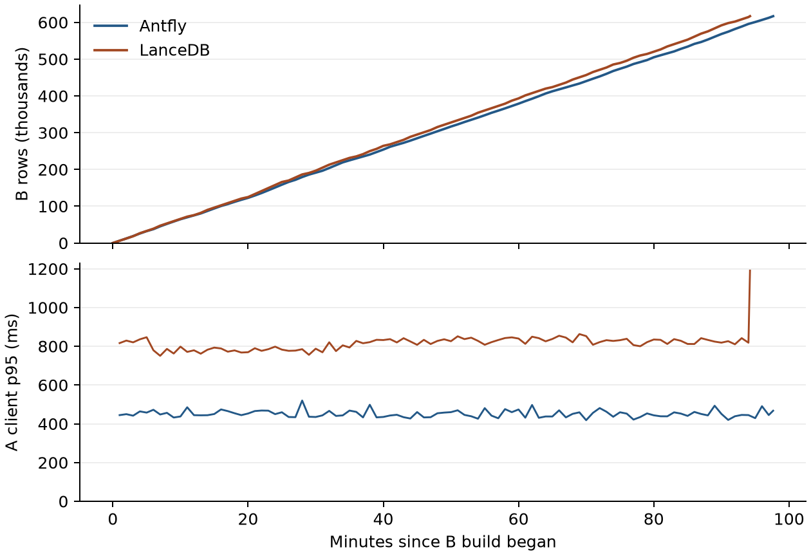

# OfficeQA Pro v2 archive results

Across a full encoder replacement, Antfly and LanceDB each served every scheduled A query at two arrivals per second. Antfly reached searchable B coverage in 97.7 minutes and LanceDB in 94.2 minutes. Neither returned an ineligible page. These are single native macOS trials on Wolfspider with a shared application-side embedding worker. The controlled native alias and durable-outbox experiments establish the separate database lifecycle claims. [Aggregate receipts](observations/officeqa-native-summary.json) · [Native contracts](../native-contracts/README.md)

Wolfspider has a 14-core Apple M4 Max and 36 GiB of unified memory. The native runs used macOS arm64, the official Antfly 0.3.1 binary (SHA-256 `c8f04db1564bf8a82d39999cb7f64798685bfbfa806827a7c41055c9bfe09e7d`), LanceDB 0.41.0 and PyArrow 26.0.1. Publisher text mapped to 115,458 of the 118,524 physical pages. Generation A used `BAAI/bge-small-en-v1.5` and B used `BAAI/bge-small-en`. The corpus preparation and timed worker used the same model weights.

The [comparability audit](COMPARABILITY.md) covers all five evolved A indexes, access boundaries, cutover semantics and latency accounting.

## Work completed during migration

| Native macOS trial | Antfly v0.3.1 | LanceDB Embedded |
| --- | ---: | ---: |
| Distinct chunks re-embedded with B | 251,707 | 251,707 |
| Physical rows searchable in B | 616,832 | 616,832 |
| B model batches | 7,866 | 7,866 |
| Wall time inside B embedding calls | 89.77 min | 91.97 min |
| Last B write acknowledged | 97.63 min | 94.05 min |
| B row counts complete and first two-channel probe passed | 97.65 min | 94.23 min |
| Client switch plus first verified B read | 221 ms | 64 ms |
| Scheduled A arrivals during migration | 11,719 | 11,308 |
| Failed or missing arrivals | 0 | 0 |
| A p95 before migration (408 arrivals) | 466 ms | 815 ms |
| A p95 during migration | 455 ms | 825 ms |

Both engines consumed the same publisher-text corpus and the same frozen query vectors. The worker re-embedded each distinct chunk once with the replacement BGE encoder, checked its direction against the prepared vector and wrote public and tenant copies. Model time measures client wall time inside embedding calls, including the round trip. Antfly acknowledged B batches at the write barrier, then checked full-text and vector coverage. LanceDB finalized its indexes and checked the row count. Each adapter issued the same eligible lexical and dense probe before cutover. The duration of the build determined how many A arrivals were scheduled. [Runner and reproduction instructions](README.md#run-one-comparison)

Each point aggregates one minute of the build. The last bin ends at readiness and may include fewer arrivals. The bundled [plotting script](migration_figure.py) reads the aggregate JSON directly.

## Which evidence pages came back?

The corpus has 1,435 PDFs, 118,524 physical pages, 90 original questions and 823 distinct cited question–page pairs. Each schema phase has 408 eligible tenant/filter variants. The client requests 100 candidates per channel and returns up to 20 distinct physical pages. Recall is the mean fraction of each variant’s eligible cited pages retrieved. “All” is the fraction of variants for which every eligible cited page was returned. [Corpus verification](observations/corpus-verification.json)

| Evolved tenant schema | Antfly recall@20 | LanceDB recall@20 | Antfly all@20 | LanceDB all@20 |
| --- | ---: | ---: | ---: | ---: |
| A lexical | 19.72% | 18.12% | 12.75% | 11.27% |
| A dense | 15.64% | 16.03% | 8.82% | 8.82% |
| A hybrid | 22.76% | 21.88% | 13.48% | 13.73% |
| B lexical | 19.96% | 18.12% | 12.75% | 11.27% |
| B dense | 15.38% | 15.43% | 8.82% | 8.82% |
| B hybrid | 23.76% | 21.91% | 14.22% | 13.97% |

Hybrid retrieval produced the highest mean recall in each trial. Giving each original question equal weight, the paired Antfly-minus-LanceDB hybrid recall difference was +1.22 percentage points for A (95% bootstrap interval −0.97 to +3.82) and +1.62 for B (−0.64 to +4.07). Both intervals include zero. The intervals resample the 90 original questions and quantify question variation. Each timing comes from one machine run per engine. Antfly enforced the tenant restriction with authenticated database readers. LanceDB used the trusted application's prefilter. [All quality cells, paired intervals and one-minute migration series](observations/officeqa-native-summary.json)

## Original questions without the tenant overlay

For the 90 original questions, the reader can search all public pages. Generation-A hybrid recall@20 was 14.17% for Antfly and 14.06% for LanceDB. Each system returned every cited page for 4 of 90 questions. This measures retrieval of the citations supplied by the dataset. End-to-end answer accuracy requires running the reader and scoring its answer. [Original-question scores](observations/officeqa-original-recall.json)

| Channel | Antfly recall@20 | LanceDB recall@20 |
| --- | ---: | ---: |
| Lexical | 10.99% | 11.02% |
| Dense | 7.85% | 8.48% |
| Hybrid | 14.17% | 14.06% |

## Scope of the other evidence

| Evidence | Coverage and interpretation |
| --- | --- |
| Five-engine retrieval qualification | All five adapters recovered the planted evidence on the public fixture. These checks establish wiring and filtering on known inputs. [Receipt](observations/matched-fixture.json) |
| Controlled backfill | With 1,024 vectors, the medians of three trials were 25.79 s for Antfly and 12.69 s for the PostgreSQL outbox. The receipts include all trials and exclusions. [Backfill receipts](observations/backfill-v031.json) |
| Remote-object OCR and graph correctness | Both Antfly and PostgreSQL passed the authored scanned-ledger correction and intermediate-node revocation cases with the shared PDF and extraction frontend. [Antfly](observations/antfly-raw-final.json) · [PostgreSQL](observations/postgres-raw-final.json) |
| Full-corpus PostgreSQL, OpenSearch and Vespa | The [Wolfspider campaign report](observations/officeqa-wolfspider-campaign.md) records results as each Linux-VM trial finishes. |
| Original-question answers and real-page extraction | End-to-end exact answer scores require reader outputs. Graph precision and recall require independent adjudicated page judgments. The publisher-text retrieval table above uses citation judgments. |

In a separate v0.3.1 check, one standalone Antfly instance took three PDF URLs and two enrichment definitions. Native extraction handled both born-digital pages, LightOnOCR-3-0.8B handled the scanned page, and the native chunker produced four searchable chunks in total. The matched application worker reported 2,094 prompt tokens and 19 completion tokens for the scan. These token counts belong to its inference API request. [Configuration](lighton-enrichments.json) · [Fixture receipt](observations/lighton-ingestion-fixture.json)

### Page-image to text-chunk migration

On the public fixture, v0.3.1's native PDF page-image index reported complete coverage of three sources and three searchable vectors. Its dense profile recorded three raw matches, but the query returned zero hits to the administrator and the tenant reader. The same three pages rendered to PNG in the application and embedded by Antfly returned three hits with the same EmbeddingGemma 2 query vector. The current release therefore fails the entry condition for the full native OfficeQA representation comparison. [Fixture receipt](observations/pdf-vector-migration-v031.json)

With the PNG starting index, all 36 live reader probes returned results during replacement. The native replacement fetched the PDFs, selected LightOnOCR-3-0.8B for the scanned ledger, and indexed four text chunks under the same model identity. During backfill the client corrected that ledger and moved the appendix out of the reader's tenant. After cutover the reader found the correction and could retrieve only the two eligible sources. In a separate two-page probe, the replacement ranked physical page 2 first for evidence unique to that page. These fixture checks establish behavior on authored inputs. Full-corpus recall, compute cost, and cross-engine latency for this migration remain unmeasured. [Reproduction](README.md#pdf-page-image-to-passage-index-qualification)
